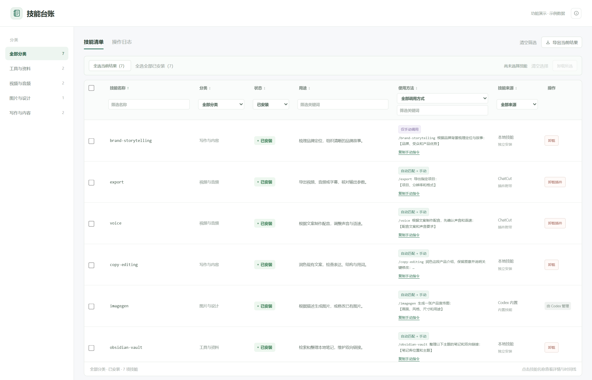
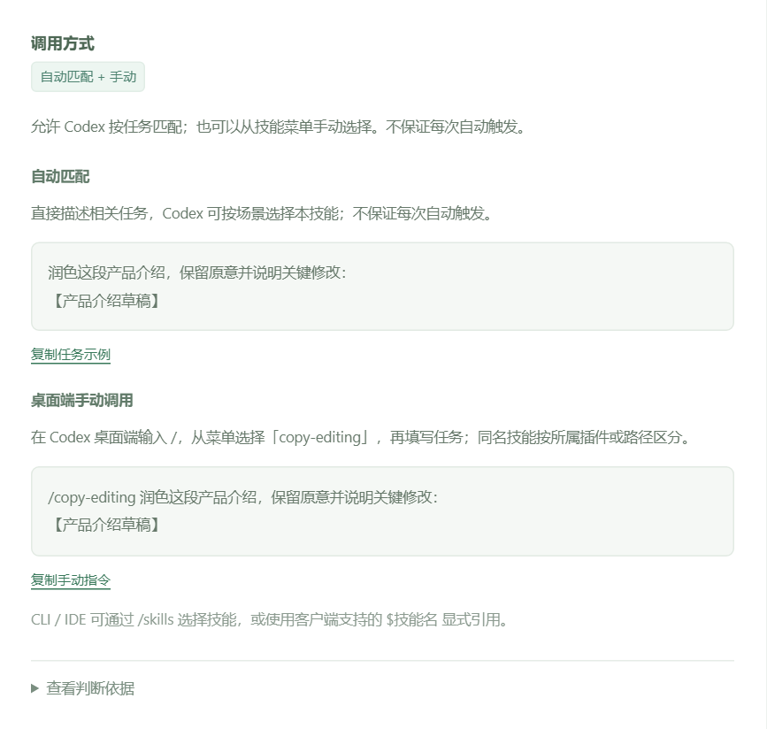
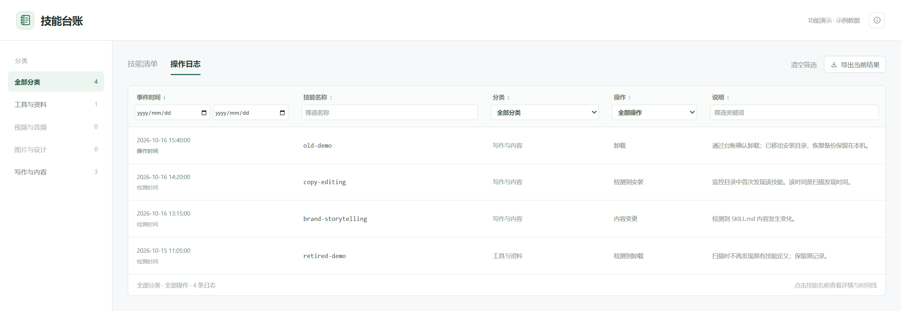
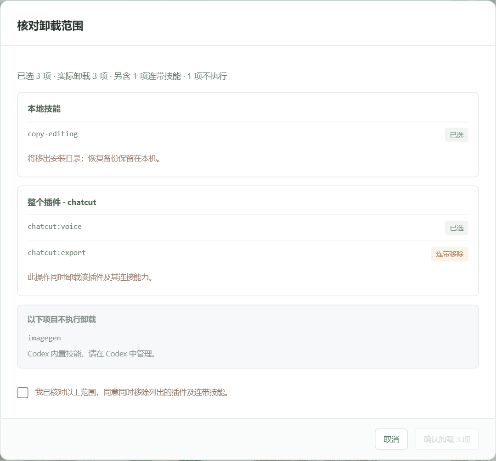

# Codex Skill 台账

一个运行在 Windows 本机的轻量 Skill 管理工具：查看安装了什么、记录何时发生变化，并在确认影响范围后卸载技能。支持登录 Windows 后自动在后台记录，无需手动维护表格。

使用 Python 标准库与原生 HTML / CSS / JavaScript，无需数据库、Node 依赖或云端服务。它是独立的本地工具，并非 OpenAI 官方产品。

## 用途

- 集中查看本机独立安装的 Skill、插件附带的 Skill 与 Codex 内置技能。
- 自动追踪新增、移除、启用设置、版本、路径与内容变化，保留历史。
- 区分真正安装的技能与仅残留在插件缓存中的文件。
- 查看技能用途、来源、本地路径、调用策略与可复制的使用示例。
- 支持单个、批量卸载，以及卸载前的范围预览。

## 界面预览

以下图片在本地运行当前界面后截取，使用示例数据展示功能；不包含个人技能清单或真实路径，卸载预览未执行真实卸载。

### 技能清单：集中查看、分类和筛选

按分类浏览已安装的技能，在表头筛选名称、状态、用途、调用方式与来源；支持全选和导出当前结果。



### 使用方法：知道何时自动匹配、怎样手动调用

技能详情区分自动匹配与手动调用，给出可复制的任务示例，并保留调用策略的判断依据。



### 操作日志：看清发生了什么、时间从何而来

安装、卸载和内容变化保留记录，明确区分实际操作时间与后台检测时间，可按日期及操作类型筛选。



### 批量卸载：先核对选中项与连带影响

确认前展示本地技能、整个插件及连带技能；不能在这里卸载的内置项目会单独说明。涉及插件或连带技能时，需先勾选确认范围。



## 已完成的功能

| 功能 | 具体行为 |
| --- | --- |
| 清晰的安装状态 | 主列表仅显示「已安装」「已卸载」；安装后关闭启用开关，仍算已安装，详细原因放在详情中 |
| 自动增量记录 | 每 15 秒扫描配置的目录；后台运行时约每 60 秒同步一次 Codex 插件安装清单 |
| 新安装统计 | 已配置目录中出现的新技能会自动纳入；插件需有配置或安装清单的确认依据 |
| 分类与表头筛选 | 按分类、名称、状态、来源、用途、调用方式筛选，支持排序和 CSV 导出 |
| 详情与变更记录 | 查看文件路径、副本、版本、时间依据、调用策略，以及该技能的历史记录 |
| 页面同步 | 切换清单和记录、浏览器前进后退、后台刷新时保留相应筛选和选择状态 |
| 使用方法 | 区分「自动匹配 + 手动」「仅手动调用」「多份策略不同」「策略待核对」，给出任务示例与判断依据 |
| 单个与批量卸载 | 支持全选当前筛选结果、全选全部已安装、清空选择；保留跨分类选择并提示隐藏项 |
| 卸载预览 | 区分选中项、连带影响和不可卸载项；插件整体卸载需要确认影响范围 |
| 本地技能备份 | 卸载时移出加载目录并保留恢复文件和操作回执；移动失败会尝试回滚 |
| 插件管理 | 调用 Codex 的插件卸载命令，避免直接删除插件缓存；内置组件显示「由 Codex 管理」 |
| 异常保护 | 必需目录或配置读取失败时停止本轮更新，避免误报卸载；插件清单不完整时保留先前确认结果 |
| 后台与开机启动 | 支持隐藏后台进程、当前用户登录后启动，以及停止并取消启动 |

## 环境要求

- Windows 10 / 11，Windows PowerShell 5.1 或兼容的 Windows PowerShell 环境。
- Python **3.11 或更新版本**。无需 `pip install`。
- 本机有 Codex 技能目录；插件管理还需要可用的 Codex 插件 CLI。
- Node.js 只用于运行前端测试，日常使用不需要。

脚本会依次寻找 PATH 中的 Python 和当前用户目录下 Codex 附带的 Python 运行环境。找不到时，安装 Python 3.11+ 并加入 PATH。

## 快速开始

```powershell
git clone https://github.com/luziyangz/codex-skill-ledger.git
cd codex-skill-ledger
python skill_ledger.py --watch --open
```

也可以双击 `open.cmd`：它会在后台运行并打开管理页面。重复打开同一目录的工具会复用已有记录器。同一台电脑建议只运行一份，避免重复扫描和重复管理。

首次启动会生成本机专用的 `设置.json` 与 `.data/`，不会修改 Codex 配置或安装任何 Skill。

默认识别：

1. `CODEX_HOME` 环境变量指定的 Codex 目录；未设置时使用当前用户的 `.codex`。
2. 该目录下的 `skills`、`plugins/cache` 和 `config.toml`。
3. 当前用户的 `.agents/skills`。

如果 Codex 使用自定义目录，第一次运行前先设置环境变量：

```powershell
$env:CODEX_HOME = 'D:\CodexHome\.codex'
python skill_ledger.py --watch --open
```

已经生成设置后，以 `设置.json` 为准。项目级或共享目录需要自行添加到 `skill_roots`，不会遍历整台电脑。之后安装到这些目录的新技能可自动检测。

### 开机后自动后台记录

双击 `install-startup.cmd`。它会为当前用户创建启动快捷方式并立即启动后台记录。

这里的「开机启动」是 **Windows 用户登录后启动**，无需管理员权限，也不依赖 Codex 窗口是否打开。只有电脑运行且用户已登录、后台进程存活时才会持续记录。

双击 `stop-and-remove-startup.cmd` 可停止本目录的后台记录器，并移除本目录创建的启动快捷方式；已有记录和恢复备份保留。

移动工具目录后，应先在原目录取消启动，再在新目录重新设置。

### 其他运行方式

```powershell
# 只扫描一次并导出 HTML / CSV，不持续后台记录
python skill_ledger.py

# 单次更新并打开只读导出页面
python skill_ledger.py --open

# 前台持续记录；Ctrl+C 停止
python skill_ledger.py --watch

# 将本机状态保存在单独目录
python skill_ledger.py --base D:\SkillLedgerData --watch --open
```

网页卸载需要 `--watch` 启动的本地管理连接。启动脚本管理的是仓库目录中的默认实例；使用自定义 `--base` 时请用命令行自行管理。

## 怎样使用界面

1. 在技能清单中选择分类，使用表头筛选定位技能。
2. 点击名称查看详情；「查看记录」会跳转到该技能的变更记录。
3. 「使用方法」提供手动调用提示、自动匹配条件和可复制任务示例。
4. 勾选技能，或全选当前结果 / 全部已安装，再点击卸载。
5. 在预览中核对全部影响范围后确认。插件提供的技能会卸载所属插件，可能同时移除该插件的其他技能。

「技能来源」表示提供方式或所属插件，不等于作者、下载地址或安装文件夹。文件位置在详情中查看。

### 调用方式如何判断

- 读取技能相邻的 `agents/openai.yaml` 中 `policy.allow_implicit_invocation`。
- `false` 表示仅手动调用；未配置时按 Codex 文档中的默认值 `true` 展示为允许自动匹配。
- 自动匹配表示允许 Codex 根据任务选择技能，**不保证每次都触发**。
- 同名多份文件策略不一致、策略格式无法可靠识别时，会显示对应的待核对说明，不直接假定支持自动匹配。
- 已卸载技能若有备份，策略来自备份并明确标注，不代表当前已经可用。

Codex 桌面端可先输入 `/`，从菜单选择技能，再填写任务，例如选择 `to-spec` 后输入需求。示例显示为 `/to-spec 任务内容`；应通过菜单核对实际技能，同名项按插件或路径区分。CLI / IDE 可通过 `/skills` 或客户端支持的 `$技能名` 显式引用，桌面端示例不是终端命令。

策略依据：[Codex 官方 Skills 文档](https://developers.openai.com/codex/skills)。具体菜单以使用的 Codex 客户端版本为准。

## 时间与状态的含义

- **已安装**：在监控范围内有技能文件，且有相应安装或配置依据；关闭启用开关不等于卸载。
- **已卸载**：曾记录过，现已从对应安装目录移除。恢复备份不算安装。
- **操作时间**：通过本工具确认卸载时记录的实际操作时间。
- **检测时间**：扫描发现外部安装、卸载或修改的时间，不冒充安装程序的执行时间。
- **首次登记**：首次扫描建立基线。之前何时安装无法追溯时，不虚构安装日期。

工具不是 Codex 运行时加载追踪器，不能证明某技能正在被会话使用。停止后台期间发生、又被还原的短暂变化可能无法发现。

## 配置与分类

`设置.json` 自动生成的字段：

| 字段 | 用途 |
| --- | --- |
| `codex_config` | 本机 Codex 的 `config.toml` 路径 |
| `skill_roots` | 独立技能根目录列表；每项含 `path`、`label`、`required` |
| `plugin_cache` | 插件缓存根目录；仅缓存文件不会直接当成已安装 |
| `plugin_cli` | 支持 `plugin list/remove --json` 的 Codex 可执行文件路径 |
| `known_plugins` | 人工确认已安装的插件名称，默认留空；通常由 CLI 安装清单自动确认 |
| `codex_config_required` / `plugin_cache_required` | 相应位置缺失时是否停止扫描 |

新设备上尚不存在的默认目录允许缺失；目录一旦出现，会提升为必需位置，后续访问失败会停止本轮更新，保护原有台账。如果确实不再监控某个目录，应明确修改设置。

分类元数据在 `.data/reference.json` 中，格式如下：

```json
{
  "copy-editing": { "category": "写作与内容" },
  "some-plugin:some-skill": { "category": "我的分类" }
}
```

首次运行包含少量常见技能分类映射，其余显示「未分类」，不会把不确定的分类当作事实。编辑后下次扫描自动更新；`purpose` 可选，用来覆盖展示用途，不填写时读取技能自身说明。

## 文件结构与本机数据

```text
skill_ledger.py           扫描、事件台账、HTML / CSV 导出与后台入口
skill_manager.py          本地管理 API、卸载预览、备份与插件操作
skill_invocation.py       调用策略解析与证据
skill_setup.py            首次运行配置与目录保护
web/                     界面模板与交互脚本
scripts/manage.ps1       Windows 后台和启动快捷方式管理
tests/                   临时数据测试与前端交互测试
```

运行后生成的本机文件：

| 文件 | 内容 |
| --- | --- |
| `设置.json` | 本机路径和管理配置 |
| `查看记录.html` | 当前清单与历史的静态页面副本 |
| `当前技能.csv` / `变更记录.csv` | 可用表格软件打开的导出文件 |
| `.data/ledger.json` | 权威台账，保存快照和历史事件 |
| `.data/reference.json` | 分类和展示元数据 |
| `.data/uninstall-backups/` | 本地技能卸载后的恢复副本与回执 |
| `.data/connection.json` | 本地管理连接与临时访问凭据 |
| `.data/运行错误.log` | 扫描或后台运行错误 |

上述本机数据已加入 `.gitignore`。仓库只提供源码，不包含个人技能清单、原始历史、路径配置、凭据或备份。备份整个 `.data` 和 `设置.json` 可保留记录，但其中含本机私密信息。

卸载不会自动清空历史；目前没有图形化恢复按钮。需要恢复本地技能时，先停止后台，在回执中核对原路径和备份目录，确认原位置未被其他文件占用后恢复，再启动记录器。插件请通过 Codex 正常重新安装。

## 本地连接与限制

管理服务仅监听 `127.0.0.1` 的随机端口，使用进程级随机访问令牌，并检查 Host 与 Origin；不向网页提供任意文件读取接口。请通过 `open.cmd` 或 `--watch --open` 打开带有管理连接的页面，避免分享地址片段或 `.data`。

扫描和记录在本机进行；插件清单与卸载通过 Codex CLI 执行，CLI 可能连接插件服务。此工具不提供远程访问、自动更新、自动安装 Skill 或完整 YAML 解析。

插件命令和缓存格式依赖当前 Codex 实现。若客户端更新导致格式变化或 CLI 不可用，先核对设置和错误日志；不会通过删缓存来替代真正的插件卸载。内置组件交由 Codex 管理。

## 测试

在仓库根目录执行：

```powershell
python -m unittest discover -s tests -p "test_*.py" -v
node tests/test_app.cjs
node tests/test_invocation_ui.cjs
```

测试使用临时技能目录、模拟插件命令及本地测试服务，覆盖基线时间、新增移除、扫描失败保护、策略判断、卸载预览与回滚、批量勾选、筛选、导航和页面同步。不会操作真实技能目录，也不会设置开机启动。
